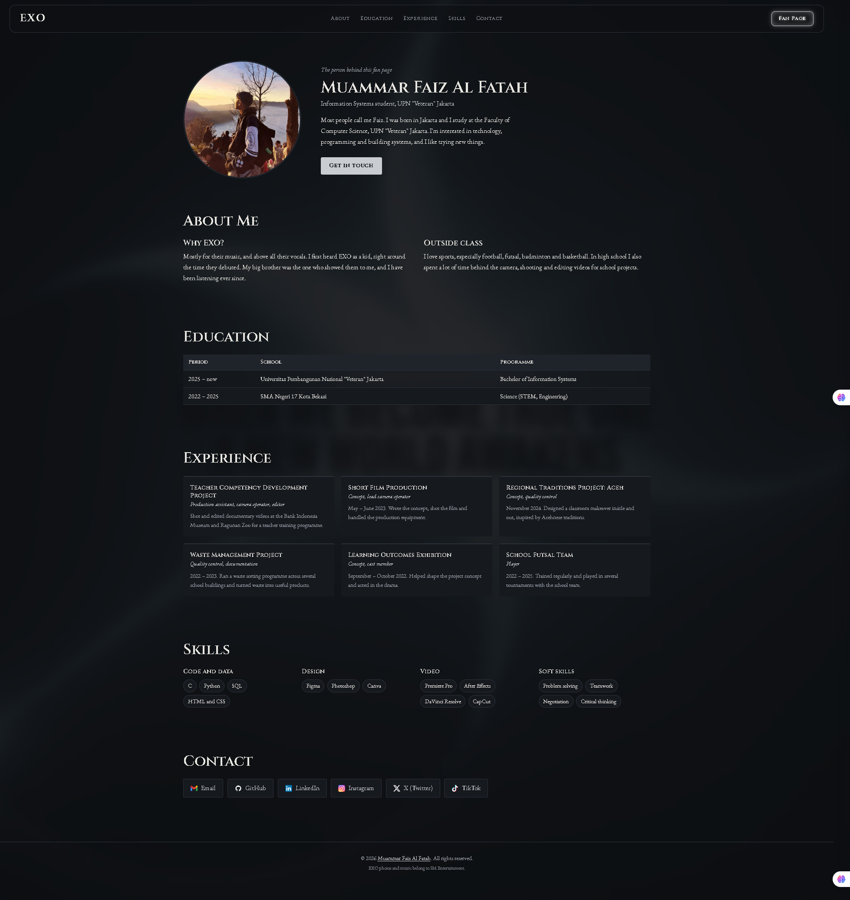

# EXO — We Are One

> *"When we become true one, a new world awakens."*

A fan page for **EXO**, built around the original twelve-member lineup and following the group all the way to today. Pure HTML and CSS, no frameworks.


## The idea

EXO debuted with a story: twelve boys from an exoplanet, each given a superpower by the Tree of Life, split into two units, EXO-K in Seoul and EXO-M in Beijing. This page tells that story first, then walks through the members, the music, and fourteen years of history, from the first teaser in 2011 to the encore concert in November 2026.

The look takes its cue from EXO's poster art: dark, silver, and a little bit ancient. Headings use Cinzel, a typeface modeled on Roman stone inscriptions, to match the legend.

## What's inside

**The 12 Members.** Every member of EXO-K and EXO-M gets a card with their superpower symbol. Hover over a card and a panel slides up with their power, profile, and social links.

**Discography.** 26 releases from *MAMA* (2012) to *REVERXE* (2026), including the separate Korean and Chinese versions. Every cover links to the album on Spotify.

**Music Videos.** The latest title track, *Crown*, plays right on the page, followed by every official music video from oldest to newest.

**Timeline.** The whole journey year by year: debut, the *Growl* breakthrough, the five straight Album of the Year wins, the lineup changes, and the tours.

**Gallery.** A scattered polaroid collage. Click any photo to open it full screen and browse through the rest.

**EXO-L Card.** A small card for fans to introduce themselves.

**About the creator.** A second page about me.



## Under the hood

A few things I enjoyed building:

- **Scroll-driven background.** The poster behind the page starts sharp and slowly blurs and darkens as you scroll, so the text stays readable. Made with two stacked pseudo-elements and `animation-timeline: scroll()`.
- **A lightbox with zero JavaScript.** The gallery viewer, including next and previous, runs entirely on CSS `:target`.
- **Pseudo-element details.** The timeline's line and dots, the play buttons on video thumbnails, and the "coming soon" tags are all drawn with `::before` and `::after`, not extra HTML.
- **Mirrored units.** EXO-M's section is EXO-K's layout flipped with a single `flex-direction: row-reverse`.
- **Keyboard friendly.** Member details also open with the Tab key (`:focus-within`), and images, icons, and table headers carry proper `alt`, `aria-label`, and `scope` attributes.
- **Responsive.** Works on desktop, tablet, and phone. On touch screens, where there's no hover, member details show up by default.

The only JavaScript on the site is one line that keeps the footer year current.

## Run it locally

```bash
git clone https://github.com/Faiz-iigle/MP-TSC-exopage.git
cd MP-TSC-exopage
```

Then open `index.html` in your browser. No build step, no dependencies.

Album covers, video thumbnails, the embedded video, and fonts load from the web, so you'll need an internet connection. The scroll blur effect looks best in Chrome or Edge.

## Project structure

```
.
├── index.html        # The fan page
├── profile.html      # About the creator
├── styles.css        # One stylesheet for both pages
├── exo12/            # Background, group, member, and symbol images
├── icon/             # Social media icons
├── personal/         # Profile photo
└── foto-halaman/     # Screenshots
```

## Built with

- HTML5
- CSS3
- [Google Fonts](https://fonts.google.com): Cinzel, EB Garamond, Gowun Batang

## Credits

- All EXO photos, music, and related content belong to **SM Entertainment**.
- Album covers via Spotify. Music videos and thumbnails via YouTube.
- This is a non-commercial fan project.

## Acknowledgments

Built as my mini project for the **Front End Basic Study Club** at TSC.

## Author

**Muammar Faiz Al Fatah**, Information Systems student at UPN "Veteran" Jakarta.

[GitHub](https://github.com/Faiz-iigle) · [LinkedIn](https://www.linkedin.com/in/muammar-al-fatah-97002a374/) · [Email](mailto:faizalfatah07@gmail.com)

*We are ONE.*
